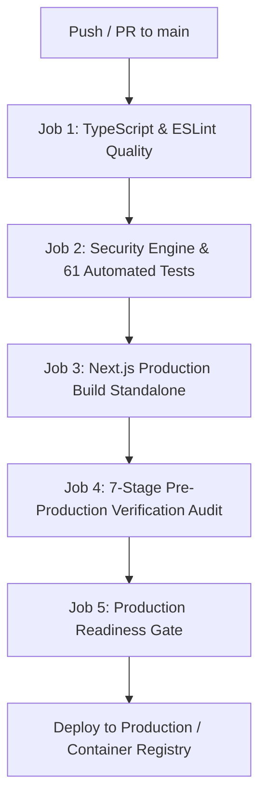

# DevKit Marketplace — Production Flow & Deployment Pipeline

This document describes the automated production flow, verification pipelines, security checks, and deployment standards for the DevKit Marketplace platform.

---

## 1. Pre-Production Verification Pipeline (`verify:prod`)

Before code is pushed to production or uploaded to any hosting environment, it must pass the **7-Stage Pre-Production Verification Pipeline**:

```bash
# Run from repository root or frontend directory:
npm run verify:prod
```

### The 7 Verification Stages

| Stage | Name | Checks Executed | Pass Criteria |
| :---: | :--- | :--- | :--- |
| **1** | **Environment Audit** | Inspects `.env.example`, verifies required variables (`MONGODB_URI`, `NEXTAUTH_SECRET`, `RAZORPAY_*`), and checks for client leaks (`NEXT_PUBLIC_` isolation). | Zero secret leaks, all required variables documented. |
| **2** | **Asset Integrity** | Audits ThreeUI and binary webp foreground assets (`kage.html`, `three.min.js`, `fonts.css`, WebP sprites). | 11 core binary and shader files verified intact. |
| **3** | **Strict TypeScript** | Runs `tsc --noEmit` across all 41+ route handlers, React 19 components, and backend modules. | 0 TypeScript compilation errors. |
| **4** | **Automated Test Suite** | Executes 61 automated tests via Node test runner + tsx. | 100% test pass rate across 21 test suites. |
| **5** | **ESLint & Web Vitals** | Runs Next.js Core Web Vitals checks and React rules of hooks enforcement. | Zero ESLint errors. |
| **6** | **Next.js Production Build** | Compiles server actions, route handlers, dynamic routes, and static pages with standalone output. | 41/41 routes compiled successfully. |
| **7** | **Bundle Verification** | Validates `.next/standalone/server.js`, client manifests, and static chunks. | Standalone production artifact ready. |

---

## 2. Automated Test Suite Breakdown (`npm test`)

The test suite contains **61 automated tests across 21 suites** covering all critical security and business logic:

```bash
# Run unit & security test suite
npm test
```

### Test Coverage Areas:

1. **Security Scanner Engine (`tests/security/scanner.test.ts`)**:
   - Path Traversal & Zip Slip prevention (`../../etc/passwd`, Windows `..\\`).
   - Dangerous binary extension filtering (`.exe`, `.bat`, `.sh`, `.ps1`, `.dll`, `.so`).
   - Secret leak detection (AWS keys, OpenAI keys, GitHub PATs, RSA private keys, `.env` files).
   - Uncompressed size bomb threshold enforcement (>150MB).
   - Health score calculation (100 for clean code).

2. **DLP Chat Filtering Engine (`tests/security/dlp-chat-filter.test.ts`)**:
   - Indian 10-digit mobile phone numbers with +91, dots, spaces, hyphens.
   - Standard and obfuscated email formats (`user [at] domain [dot] com`).
   - Package scope & semver safety (`@auth/core`, `15.1.0` allowed).
   - WhatsApp URLs and off-platform solicitation (`wa.me`, `chat on wa`).
   - UPI handle masking (`@okaxis`, `@paytm`, `@ybl`, `@oksbi`, `@upi`).
   - External social handles (Telegram, Discord, Twitter/X).
   - Unicode homoglyph normalization (NFKC).

3. **Cryptographic Payment Verification (`tests/payments/razorpay-verification.test.ts`)**:
   - HMAC-SHA256 signature calculation and verification.
   - Tampered signature rejection.
   - Invalid secret rejection.
   - Webhook payload cryptographic verification and tampering protection.

4. **RBAC Authorization Roles (`tests/auth/rbac-permissions.test.ts`)**:
   - `admin`: elevated access (admin panel, chat moderation, user management, subscriptions).
   - `operator`: chat observation and intervention without admin panel permissions.
   - `user`: buyer and seller capabilities without chat intervention permissions.
   - Tampered and invalid role rejection.

5. **Marketplace Catalog Integrity (`tests/data/marketplace-integrity.test.ts`)**:
   - Unique IDs and unique slugs across all DevKits.
   - Finite, non-negative pricing (INR and USD).
   - Category mapping integrity against registered categories.
   - Mandatory metadata completeness (title, tagline, description, features, techStack).

6. **Environment & Secret Isolation (`tests/config/environment.test.ts`)**:
   - Verification that no private server secret carries `NEXT_PUBLIC_` prefix.
   - Verification of `.env.example` template completeness.

---

## 3. GitHub Actions CI/CD Pipeline

The repository includes `.github/workflows/production-pipeline.yml` which triggers on every pull request and push to `main`:



---

## 4. Containerized Docker Deployment

### Multi-Stage Standalone Build
The `Dockerfile` produces an ultra-lean Alpine container (<120MB) utilizing Next.js standalone mode and a non-root system user (`nextjs:nodejs`).

### Build & Run Locally with Docker Compose:
```bash
# Build and start container
docker-compose up --build -d

# View container logs
docker-compose logs -f web

# Check health endpoint
curl http://localhost:3000/api/health
```

---

## 5. Production Environment Variables Reference

Ensure the following variables are configured in your production hosting environment (Vercel, AWS ECS, or Docker):

| Variable Name | Environment | Required | Description |
| :--- | :---: | :---: | :--- |
| `MONGODB_URI` | Server | Yes | MongoDB Atlas production connection string |
| `NEXTAUTH_SECRET` | Server | Yes | 64-character random hex string for session encryption |
| `NEXTAUTH_URL` | Server | Yes | Canonical production URL (e.g. `https://devkit.market`) |
| `RAZORPAY_KEY_ID` | Server | Yes | Razorpay live API key ID |
| `RAZORPAY_KEY_SECRET` | Server | Yes | Razorpay live API secret key |
| `RAZORPAY_WEBHOOK_SECRET` | Server | Yes | Razorpay webhook cryptographic signing secret |
| `NEXT_PUBLIC_APP_URL` | Client/Server | Yes | Publicly accessible production origin |
| `NEXT_PUBLIC_RAZORPAY_KEY_ID` | Client | Yes | Public Razorpay key for checkout modal |
| `GITHUB_CLIENT_ID` | Server | Optional | GitHub OAuth app client ID |
| `GITHUB_CLIENT_SECRET` | Server | Optional | GitHub OAuth app secret |
| `GOOGLE_CLIENT_ID` | Server | Optional | Google Cloud OAuth client ID |
| `GOOGLE_CLIENT_SECRET` | Server | Optional | Google Cloud OAuth client secret |

---

## 6. Health Check & Monitoring Probes

The application provides a dedicated production health check endpoint:

- **Endpoint**: `GET /api/health`
- **Response**:
  ```json
  {
    "status": "ok",
    "service": "devkit-marketplace",
    "environment": "production",
    "timestamp": "2026-10-15T12:49:00.000Z",
    "uptimeSeconds": 1420,
    "version": "1.0.0"
  }
  ```
- **Probe Configuration**: Interval 30s, Timeout 5s, Retries 3.
