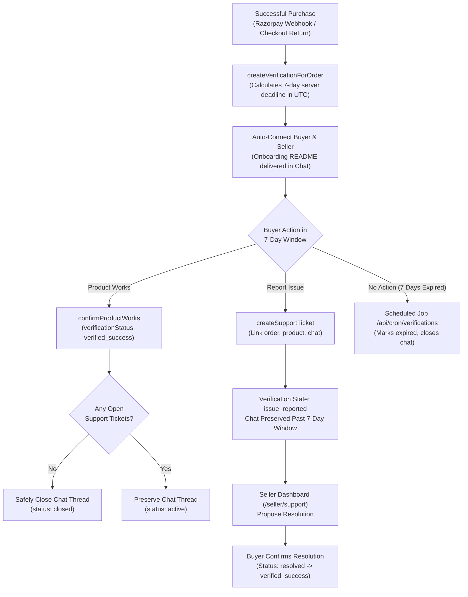

# DevKit Marketplace — Verified Next.js 15 Integration Platform

[](https://nextjs.org/)
[](https://react.dev/)
[](https://www.typescriptlang.org/)
[](https://www.mongodb.com/)
[](https://nodejs.org/api/test.html)
[](file:///E:/codebase/code-marketplace/scripts/verify-production.mjs)

A production-grade developer marketplace and verification engine for verified Next.js 15 starter templates, payment integration kits, repositories, prompts, and AI blueprints. DevKit eliminates abandoned boilerplate code through server-enforced **7-Day Product Verification Windows**, direct **Buyer–Seller Support Chat** with anti-leakage protection, and an automated **Customer Support Ticket Lifecycle**.

---

## 📑 Table of Contents

- [Core Platform Capabilities](#-core-platform-capabilities)
- [7-Day Verification & Support Lifecycle Architecture](#-7-day-verification--support-lifecycle-architecture)
- [System Architecture & Directory Map](#-system-architecture--directory-map)
- [Tech Stack](#-tech-stack)
- [Getting Started](#-getting-started)
- [Environment Variables](#-environment-variables)
- [Automated Testing Suite (96 Tests)](#-automated-testing-suite-96-tests)
- [Production Verification Pipeline (7 Stages)](#-production-verification-pipeline-7-stages)
- [Docker & Deployment](#-docker--deployment)
- [API Reference](#-api-reference)

---

## 🌟 Core Platform Capabilities

1. **7-Day Product Verification Window**: Every eligible paid purchase starts an authoritative 7-day UTC testing window. If everything works cleanly, the buyer confirms "Product Works".
2. **Customer Support Ticket Lifecycle**: If a template or integration fails, the buyer submits an issue ticket with full environment diagnostics (OS, Node version, runtime, error logs). The ticket remains open past the 7-day window until the seller resolves it.
3. **Automated Chat Lifecycle & Follow-Up Reminders**:
   - Verification-only chat conversations are automatically closed once the product is verified or after 7 days without reported issues.
   - Open support tickets keep chat threads active indefinitely until resolved.
   - Automated cron sends 24-hour and 48-hour inactivity reminders to keep resolution moving.
4. **Data Leakage Protection (DLP) Chat Shield**: Real-time inspection masks external contact details (phone numbers, emails, WhatsApp handles, UPI IDs) to keep transactions protected inside the platform while preserving code blocks and technical queries.
5. **Authoritative Pricing & Seller Quotas**: Server-authoritative catalog pricing prevents client-side price tampering. Free-tier sellers are capped at 3 listings, with unlimited listings for Pro subscribers.
6. **Static Security Scanner Gate**: Scans published kit file trees, automatically rejecting files containing plaintext AWS, Razorpay, or OpenAI API keys before going live.
7. **Developer Profiles, Repositories & Discussions**: Public and private repositories (`/repos`), GitHub-style developer profile pages (`/[username]`), collaborative project task boards (`/projects`), and technical discussion forums (`/discussions`).
8. **AI Prompt Marketplace & Studio**: Curated system prompts (`/prompts`) and a multi-provider AI Generation Studio (`/studio`) with honest provider availability reporting (OpenAI, Anthropic Claude, Google Gemini).

---

## 🛡️ 7-Day Verification & Support Lifecycle Architecture



---

## 📂 System Architecture & Directory Map

```text
code-marketplace/
├── 📂 backend/                                   # Domain Logic, Models & Security Services
│   ├── 📂 auth/                                  # RBAC permission matrix (Admin, Operator, Seller, Buyer)
│   ├── 📂 chat/                                  # DLP Filter, chat dispatch, operator safety tools
│   │   ├── 📄 filter.ts                          # Regex DLP Shield (masks phone, email, wa, upi)
│   │   ├── 📄 operator.ts                        # Moderator oversight & system announcements
│   │   └── 📄 service.ts                         # autoConnectBuyerSeller, message persistence
│   └── 📂 models/                                # MongoDB Schema Definitions
│       ├── 📄 Conversation.ts                    # Chat thread state, closure reasons, timestamps
│       ├── 📄 Message.ts                         # Raw & sanitized messages, metadata, violation flags
│       └── 📄 User.ts                            # Platform user roles and listing quota tracker
│
├── 📂 frontend/                                  # Next.js 15 App Router & React 19 Frontend
│   ├── 📂 app/                                   # App Router Pages & API Route Handlers
│   │   ├── 📂 api/                               # Server-Only Route Handlers
│   │   │   ├── 📂 admin/                         # Admin platform metrics & user role promotion
│   │   │   ├── 📂 chat/                          # Chat thread queries & message posting
│   │   │   ├── 📂 checkout/                      # Order creation & HMAC-SHA256 signature verification
│   │   │   ├── 📂 cron/verifications/            # Scheduled 7-day expiration & 24h/48h reminders
│   │   │   ├── 📂 discussions/                   # Technical forum threads & comments
│   │   │   ├── 📂 download/                      # Token-gated secure download delivery
│   │   │   ├── 📂 health/                        # Platform health checks & service readiness
│   │   │   ├── 📂 kits/                          # Catalog queries & kit publishing gate
│   │   │   ├── 📂 notifications/                 # In-app persistent notification polling & read-marks
│   │   │   ├── 📂 projects/                      # Collaborative task board CRUD
│   │   │   ├── 📂 prompts/                       # AI prompt catalog & star ratings
│   │   │   ├── 📂 repos/                         # Code repository management
│   │   │   ├── 📂 security/                      # Static secret scanner endpoint
│   │   │   ├── 📂 studio/                        # AI generation endpoint (OpenAI, Claude, Gemini)
│   │   │   ├── 📂 support/tickets/               # Support tickets, resolution proposals & confirmation
│   │   │   ├── 📂 user/profile/                  # Developer profile persistence
│   │   │   ├── 📂 verifications/                 # Product verification window queries & confirmations
│   │   │   └── 📂 webhooks/razorpay/             # Authoritative async payment webhook
│   │   ├── 📂 buyer/verifications/               # Buyer Product Verification Dashboard
│   │   ├── 📂 seller/support/                    # Seller Customer Support & Ticket Desk
│   │   ├── 📂 seller/my-kits/                    # Seller product catalogue & listing management
│   │   ├── 📂 seller/new-kit/                    # Kit publishing workflow with live security scanner
│   │   ├── 📂 admin/                             # Admin Console (platform revenue, users, audits)
│   │   ├── 📂 operator/                          # Moderation Desk for flagged DLP chat messages
│   │   ├── 📂 chat/                              # 3-Panel In-App Chat Hub with order/verification context
│   │   ├── 📂 kits/                              # Marketplace Catalog & Product Detail Pages
│   │   ├── 📂 order/success/                     # Order confirmation, download token & chat entry
│   │   ├── 📂 repos/                             # Repository browser & source code inspector
│   │   ├── 📂 discussions/                       # Developer discussion threads
│   │   ├── 📂 projects/                          # Project task management boards
│   │   ├── 📂 prompts/                           # Prompt Marketplace
│   │   ├── 📂 studio/                            # AI Blueprint Generation Studio
│   │   └── 📄 page.tsx                           # High-performance landing page with Three.js hero
│   │
│   ├── 📂 components/                            # Modular UI Components & Widgets
│   │   ├── 📂 auth/                              # Authentication modals & RBAC role switcher
│   │   ├── 📂 chat/                              # Chat window, anti-leak alerts, message list
│   │   ├── 📂 checkout/                          # Razorpay client checkout modal
│   │   ├── 📂 kage/                              # Dynamic Three.js 3D background canvas
│   │   ├── 📂 kits/                              # Kit cards, test badges, limitation notices
│   │   ├── 📂 ui/                                # Button, Card, Badge, Input primitives
│   │   ├── 📄 navbar.tsx                         # Global navigation with quick search (⌘K) & user menu
│   │   ├── 📄 notification-center.tsx            # Live in-app notification center
│   │   └── 📄 command-palette.tsx                # Instant search modal for kits, repos & pages
│   │
│   ├── 📂 lib/                                   # MongoDB Client & Data Repositories
│   │   ├── 📂 db/                                # Modular Server-Side Data Layer
│   │   │   ├── 📄 admin.ts                       # Revenue calculations & role transitions
│   │   │   ├── 📄 discussions.ts                 # Forum persistence
│   │   │   ├── 📄 kits.ts                        # Authoritative kit catalog storage
│   │   │   ├── 📄 notifications.ts               # Persistent notification items
│   │   │   ├── 📄 orders.ts                      # Order creation & paid-status marking
│   │   │   ├── 📄 profiles.ts                    # Developer profiles & bio updates
│   │   │   ├── 📄 projects.ts                    # Project tasks and status transitions
│   │   │   ├── 📄 prompts.ts                     # AI prompts & templates
│   │   │   ├── 📄 repositories.ts                # Git repositories & star management
│   │   │   ├── 📄 studio.ts                      # Multi-provider AI generation engine
│   │   │   ├── 📄 tickets.ts                     # Support ticket lifecycle & cron reminders
│   │   │   └── 📄 verifications.ts               # 7-day verification windows & audit events
│   │   ├── 📄 mongodb.ts                         # Reusable pooled MongoDB Atlas connection manager
│   │   └── 📄 auth-context.tsx                   # Client-side session and auth context
│   │
│   ├── 📂 scripts/                               # Production Verification Pipeline Script
│   │   └── 📄 verify-production.mjs              # 7-stage pre-production validation runner
│   │
│   ├── 📂 tests/                                 # Automated Test Suites (96 Tests)
│   │   ├── 📂 admin/                             # Platform revenue & role promotion tests
│   │   ├── 📂 auth/                              # RBAC permission matrix tests
│   │   ├── 📂 config/                            # Environment & secret isolation tests
│   │   ├── 📂 data/                              # Marketplace integrity & authoritative kit tests
│   │   ├── 📂 payments/                          # Razorpay cryptographic HMAC verification tests
│   │   ├── 📂 projects/                          # Tasks & discussions data model tests
│   │   ├── 📂 security/                          # Static scanner & DLP chat filter tests
│   │   ├── 📂 studio/                            # AI Studio provider & project output tests
│   │   ├── 📂 support/                           # Support ticket transitions & cron reminder tests
│   │   ├── 📂 verifications/                     # 7-day window & product works action tests
│   │   └── 📄 index.ts                           # Master test suite entry point
│   │
│   ├── 📄 auth.ts                                # Auth.js / NextAuth configuration
│   ├── 📄 package.json                           # Next.js 15, React 19, MongoDB 6 dependencies
│   ├── 📄 Dockerfile                             # Multi-stage production container build
│   └── 📄 .dockerignore                          # Build artifact exclusions
│
├── 📂 .github/workflows/                         # GitHub Actions CI/CD Pipeline
│   └── 📄 deploy.yml                             # Automated lint, test, build, and deploy workflow
├── 📄 docker-compose.yml                         # Local Docker container orchestration
├── 📄 DEPLOYMENT.md                              # Production deployment checklist & instructions
└── 📄 package.json                               # Root workspace delegator
```

---

## 🛠️ Tech Stack

| Layer | Technology |
|---|---|
| **Framework** | Next.js 15.1.0 (App Router, Server Actions, Route Handlers) |
| **UI Library** | React 19.0.0, Tailwind CSS 3.4.14, Lucide React 1.57.0 |
| **3D Graphics** | Three.js 0.186.1, `@designcodeio/threeui` |
| **Language** | TypeScript 5.6.3 (Strict Mode) |
| **Database** | MongoDB 6.12.0 (MongoDB Atlas, Connection Pooling) |
| **Authentication** | Auth.js / NextAuth 5.0-beta (GitHub, Google, Credentials, RBAC) |
| **Payments** | Razorpay (HMAC-SHA256 Signatures, Webhook Ingestion) |
| **Testing** | Node.js Test Runner (`tsx --test`), 96 Automated Tests |
| **Containerization**| Docker, Docker Compose (Multi-stage build) |

---

## 🚀 Getting Started

### Prerequisites

- **Node.js**: v20.x LTS or higher
- **npm**: v10.x or higher
- **MongoDB**: MongoDB Atlas URI or local instance

### Installation & Local Setup

1. **Clone the repository:**
   ```bash
   git clone https://github.com/your-org/code-marketplace.git
   cd code-marketplace
   ```

2. **Install dependencies:**
   ```bash
   cd frontend
   npm install
   ```

3. **Configure environment variables:**
   ```bash
   cp .env.example .env.local
   ```
   *Edit `.env.local` with your MongoDB connection string and Razorpay test credentials.*

4. **Run development server:**
   ```bash
   npm run dev
   ```

5. **Open the application:**
   Navigate to [http://localhost:3000](http://localhost:3000).

---

## 🔑 Environment Variables

The application requires the following environment variables. None of the secret keys should ever have a `NEXT_PUBLIC_` prefix:

```env
# MongoDB Atlas Database Connection
MONGODB_URI=mongodb+srv://<username>:<password>@cluster.mongodb.net/devkit?retryWrites=true&w=majority

# NextAuth / Auth.js Configuration
AUTH_SECRET=your_nextauth_cryptographic_secret_minimum_32_chars
NEXTAUTH_URL=http://localhost:3000

# Razorpay Payment Gateway Keys
RAZORPAY_KEY_ID=rzp_test_your_key_id
RAZORPAY_KEY_SECRET=your_razorpay_key_secret
RAZORPAY_WEBHOOK_SECRET=your_razorpay_webhook_secret

# Automated Cron Execution Secret
CRON_SECRET=your_secret_for_cron_endpoints

# OAuth Providers (Optional in local development)
GITHUB_CLIENT_ID=your_github_oauth_client_id
GITHUB_CLIENT_SECRET=your_github_oauth_client_secret
GOOGLE_CLIENT_ID=your_google_oauth_client_id
GOOGLE_CLIENT_SECRET=your_google_oauth_client_secret

# AI Studio Providers (Optional)
OPENAI_API_KEY=sk-proj-...
ANTHROPIC_API_KEY=sk-ant-...
GEMINI_API_KEY=AIzaSy...
```

---

## 🧪 Automated Testing Suite (96 Tests)

DevKit includes 96 automated tests verifying payment cryptography, data leakage protection, RBAC rules, 7-day window calculations, and support ticket lifecycles using deterministic virtual clocks.

```bash
cd frontend
npm test
```

### Test Suite Inventory:

- **Security & DLP**: Static API secret scanner, contact leakage inspection (phone, email, WhatsApp, UPI masking).
- **Payment Verification**: Cryptographic HMAC-SHA256 signature verification, timing attack prevention.
- **RBAC & Authorization**: Admin, operator, seller, and buyer access gates.
- **Catalog & Pricing Defense**: Authoritative price checking, anti-tampering, seller listing quota thresholds.
- **7-Day Product Verification**: UTC deadline calculation, idempotency, "Product Works" actions, safe chat closure.
- **Support Ticket Lifecycle**: Issue reporting, state machine transitions, 7-day expiration cron, 24h/48h inactivity reminders.
- **AI Studio & Projects**: Provider detection, task board status transitions, forum thread invariants.

---

## 🛡️ Production Verification Pipeline (7 Stages)

Before deploying to production, execute the comprehensive 7-stage verification script:

```bash
cd frontend
npm run verify:prod
```

```text
================================================================
       🚀 DEVKIT PLATFORM — PRODUCTION VERIFICATION PIPELINE       
================================================================

  [Stage 1] ✓ PASS  Environment & Secret Isolation Audit           0.00s
  [Stage 2] ✓ PASS  ThreeUI & Static Asset Integrity Verification  0.00s
  [Stage 3] ✓ PASS  TypeScript Strict Compilation (tsc --noEmit)   6.20s
  [Stage 4] ✓ PASS  Automated Test Suite (Security, DLP, RBAC)     2.34s (96 tests passed)
  [Stage 5] ✓ PASS  ESLint & Core Web Vitals Audit                 4.27s
  [Stage 6] ✓ PASS  Next.js Optimized Production Build             54.18s
  [Stage 7] ✓ PASS  Production Bundle & Output Verification        0.00s

✅ ALL 7 STAGES PASSED: Platform is 100% verified and ready for production!
```

---

## 🐳 Docker & Deployment

### Build & Run with Docker:

```bash
# Build production Docker image
docker build -t devkit-marketplace:latest ./frontend

# Run container
docker run -p 3000:3000 --env-file ./frontend/.env.local devkit-marketplace:latest
```

### Run with Docker Compose:

```bash
docker compose up -d --build
```

For complete cloud deployment instructions (AWS ECS, Google Cloud Run, Vercel, Docker Swarm), refer to [`DEPLOYMENT.md`](file:///E:/codebase/code-marketplace/DEPLOYMENT.md).

---

## 📡 API Reference

### Product Verifications & Support
| Method | Endpoint | Description |
|---|---|---|
| `GET` | `/api/verifications` | Fetch verifications for buyer, seller, or order ID |
| `POST` | `/api/verifications` | Confirm "Product Works" (`confirm_works`) |
| `GET` | `/api/support/tickets` | Query support tickets by user or verification ID |
| `POST` | `/api/support/tickets` | Submit a diagnostic defect ticket during verification |
| `GET` | `/api/support/tickets/[id]` | Get ticket details and chronological event timeline |
| `PATCH`| `/api/support/tickets/[id]` | Propose resolution, confirm resolution, or reopen |
| `GET` / `POST` | `/api/cron/verifications` | Trigger automated 7-day expirations and 24h/48h follow-up reminders |

### Checkout & Payments
| Method | Endpoint | Description |
|---|---|---|
| `POST` | `/api/checkout/create-order` | Create order in MongoDB and Razorpay |
| `POST` | `/api/checkout/verify-payment` | Verify HMAC-SHA256 signature, mark paid, auto-connect chat & start verification |
| `POST` | `/api/webhooks/razorpay` | Authoritative asynchronous webhook handler |
| `GET` | `/api/download/[token]` | Token-gated secure code package download |

### Chat & Moderation
| Method | Endpoint | Description |
|---|---|---|
| `GET` | `/api/chat/conversations` | Get active user conversations or operator queue |
| `GET` | `/api/chat/[id]/messages` | Fetch messages for a conversation |
| `POST` | `/api/chat/[id]/messages` | Dispatch message with real-time DLP anti-leak sanitization |

---

## 📄 License

This project is licensed under the MIT License. Integration kits and templates distributed through the marketplace include commercial developer licenses with royalty-free redistribution for client and SaaS deliverables.
