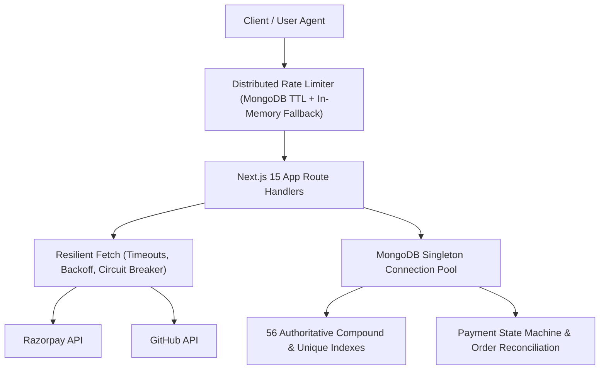
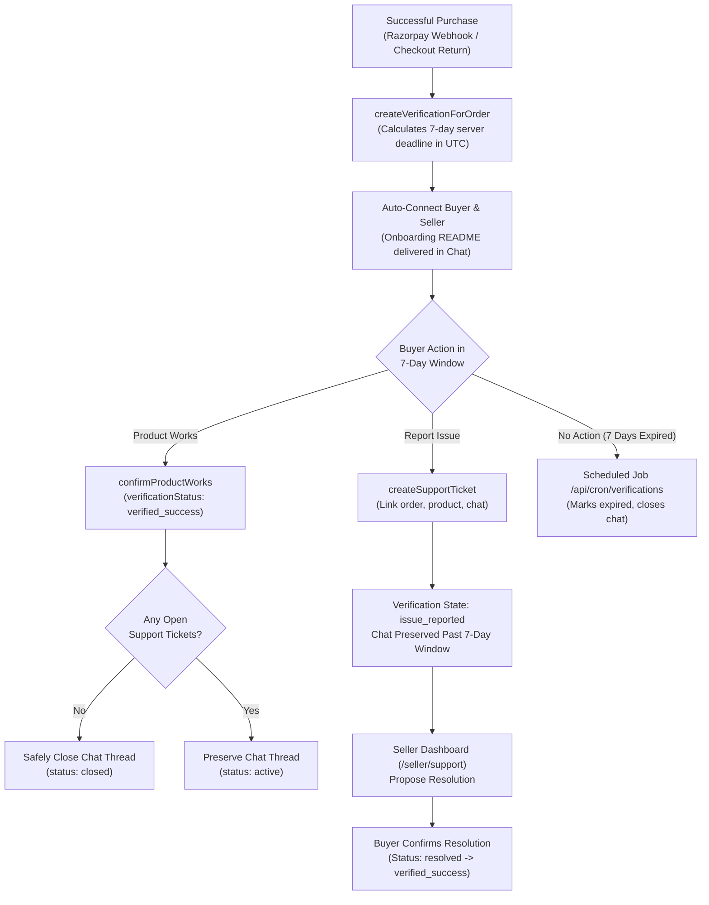

# DevKit Marketplace — Verified Next.js 15 Integration Platform

[](https://nextjs.org/)
[](https://react.dev/)
[](https://www.typescriptlang.org/)
[](https://www.mongodb.com/)
[](https://nodejs.org/api/test.html)
[](frontend/lib/security/rate-limit.ts)
[](frontend/scripts/init-indexes.mjs)
[](frontend/app/api/health/route.ts)

A production-grade developer marketplace and verification engine for verified Next.js 15 starter templates, payment integration kits, repositories, prompts, and AI blueprints. DevKit eliminates abandoned boilerplate code through server-enforced **7-Day Product Verification Windows**, direct **Buyer–Seller Support Chat** with anti-leakage protection, an automated **Customer Support Ticket Lifecycle**, and production-grade **reliability and rate limiting infrastructure**.

---

## 📑 Table of Contents

- [Core Platform Capabilities](#-core-platform-capabilities)
- [Production Engineering & Reliability](#-production-engineering--reliability)
- [7-Day Verification & Support Lifecycle Architecture](#-7-day-verification--support-lifecycle-architecture)
- [System Architecture & Directory Map](#-system-architecture--directory-map)
- [Tech Stack](#-tech-stack)
- [Getting Started](#-getting-started)
- [Environment Variables](#-environment-variables)
- [Automated Testing Suite (123 Tests across 15 Suites)](#-automated-testing-suite-123-tests-across-15-suites)
- [Database Migrations & Backup Tooling](#-database-migrations--backup-tooling)
- [Production Verification Pipeline](#-production-verification-pipeline)
- [Docker & Deployment](#-docker--deployment)
- [API Reference](#-api-reference)
- [License](#-license)

---

## 🌟 Core Platform Capabilities

1. **7-Day Product Verification Window**: Every eligible paid purchase starts an authoritative 7-day UTC testing window. If everything works cleanly, the buyer confirms "Product Works".
2. **Customer Support Ticket Lifecycle**: If a template or integration fails, the buyer submits an issue ticket with full environment diagnostics (OS, Node version, runtime, error logs). The ticket remains open past the 7-day window until the seller resolves it.
3. **Automated Chat Lifecycle & Follow-Up Reminders**:
   - Verification-only chat conversations are automatically closed once the product is verified or after 7 days without reported issues.
   - Open support tickets keep chat threads active indefinitely until resolved.
   - Automated cron sends 24-hour and 48-hour inactivity reminders to keep resolution moving.
4. **Data Leakage Protection (DLP) Chat Shield**: Real-time inspection masks external contact details (phone numbers, emails, WhatsApp handles, UPI IDs) to keep transactions protected inside the platform while preserving code blocks and technical queries.
5. **Authoritative Pricing & Seller Quotas**: Server-authoritative catalog pricing prevents client-side price tampering. Free-tier sellers are capped at 3 listings, with unlimited listings for Pro subscribers.
6. **Static Security Scanner Gate**: Scans published kit file trees, automatically rejecting files containing plaintext AWS, Razorpay, or OpenAI API keys before going live.
7. **Developer Profiles, Repositories & Discussions**: Public and private repositories (`/repos`), GitHub-style developer profile pages (`/[username]`), collaborative project task boards (`/projects`), and technical discussion forums (`/discussions`).
8. **AI Prompt Marketplace & Studio**: Curated system prompts (`/prompts`) and a multi-provider AI Generation Studio (`/studio`) with honest provider availability reporting (OpenAI, Anthropic Claude, Google Gemini).
9. **Controlled Beta & Customer Feedback Engine**: Dedicated buyer and seller guidelines, refund guarantee disclosures, privacy-conscious product analytics, and an integrated feedback system (`/feedback`).

---

## 🛡️ Production Engineering & Reliability

DevKit Marketplace features a complete production engineering layer built to withstand high traffic, network interruptions, and malicious traffic:



### 1. Distributed Rate Limiting Engine (`frontend/lib/security/rate-limit.ts`)
- Backed by MongoDB atomic `findOneAndUpdate` with a TTL index on `expireAt`.
- Resilient in-memory sliding window fallback during database reconnects.
- RFC 6585 standard headers (`X-RateLimit-Limit`, `X-RateLimit-Remaining`, `X-RateLimit-Reset`, `Retry-After`).
- Tiered per-operation policies:
  - `checkout`: 15 requests / min
  - `chat`: 30 messages / min
  - `scanner`: 10 scans / min
  - `feedback`: 5 submissions / 10 min
  - `studio`: 8 projects / min
  - `auth`: 10 attempts / 15 min
  - `general`: 100 requests / min

### 2. SSRF & Security Input Validation (`frontend/lib/security/validation.ts`)
- **SSRF Defense**: `validateGitHubUrl()` validates that repository imports only use `https://github.com/owner/repo`, blocking requests targeting localhost, AWS/cloud metadata (`169.254.169.254`), private IP subnets, or arbitrary protocol handlers.
- **NoSQL Injection Sanitization**: Strips `$` and `.` MongoDB operators from user payloads.
- **Constant-Time Verification**: Prevents timing attacks across Razorpay HMAC signatures and cron secret tokens.

### 3. Resilient Fetch & Circuit Breaker (`frontend/lib/utils/resilient-fetch.ts`)
- Request timeouts via `AbortSignal` (8s for Razorpay, 5s for GitHub).
- Exponential backoff with jitter on network/5xx transient failures.
- Permanent 4xx client errors are never retried.
- Host-level circuit breaker trips after 5 consecutive failures with a 30s cooldown window.

### 4. Payment Failure Lifecycle & Reconciliation (`frontend/lib/db/orders.ts`)
- Explicit order states: `created`, `paid`, `failed`, `cancelled`.
- `markOrderAsFailed()`: revokes download rights immediately (`downloadExpiresAt = now`).
- `reconcileOrder()`: detects discrepancies between orders, payment tokens, and 7-day verification records.

### 5. Deep Health Check & Observability (`/api/health`)
- **Shallow probe** (`?shallow=true`): Fast 200 OK for load balancers.
- **Deep readiness probe**: Pings MongoDB with latency measurement, reports memory heap usage (`heapUsedMB`, `heapTotalMB`, `rssMB`), and verifies required secrets.

---

## 🛡️ 7-Day Verification & Support Lifecycle Architecture



---

## 📂 System Architecture & Directory Map

```text
code-marketplace/
├── 📂 backend/                                   # Domain Logic, Models & Security Services
│   ├── 📂 auth/                                  # RBAC permission matrix (Admin, Operator, Seller, Buyer)
│   ├── 📂 chat/                                  # DLP Filter, chat dispatch, operator safety tools
│   │   ├── 📄 filter.ts                          # Regex DLP Shield (masks phone, email, wa, upi)
│   │   ├── 📄 operator.ts                        # Moderator oversight & system announcements
│   │   └── 📄 service.ts                         # autoConnectBuyerSeller, message persistence
│   └── 📂 models/                                # MongoDB Schema Definitions
│       ├── 📄 Conversation.ts                    # Chat thread state, closure reasons, timestamps
│       ├── 📄 Message.ts                         # Raw & sanitized messages, metadata, violation flags
│       └── 📄 User.ts                            # Platform user roles and listing quota tracker
│
├── 📂 frontend/                                  # Next.js 15 App Router & React 19 Frontend
│   ├── 📂 app/                                   # App Router Pages & API Route Handlers
│   │   ├── 📂 api/                               # Server-Only Route Handlers
│   │   │   ├── 📂 admin/                         # Admin platform metrics & user management
│   │   │   ├── 📂 admin/analytics/               # Beta funnel conversion analytics
│   │   │   ├── 📂 analytics/                     # Privacy-sanitized event ingestion
│   │   │   ├── 📂 chat/                          # Chat queries & message posting with DLP
│   │   │   ├── 📂 checkout/                      # Order creation & HMAC-SHA256 verification
│   │   │   ├── 📂 cron/verifications/            # Scheduled 7-day expiration & reminders
│   │   │   ├── 📂 discussions/                   # Technical forum threads & comments
│   │   │   ├── 📂 download/                      # Token-gated secure code package download
│   │   │   ├── 📂 feedback/                      # Beta customer feedback collection
│   │   │   ├── 📂 health/                        # Shallow liveness & deep readiness probes
│   │   │   ├── 📂 kits/                          # Catalog queries & kit publishing gate
│   │   │   ├── 📂 notifications/                 # In-app persistent notification polling
│   │   │   ├── 📂 seller/inspect-repo/           # SSRF-protected GitHub repo inspector
│   │   │   ├── 📂 support/tickets/               # Support tickets & resolution lifecycle
│   │   │   ├── 📂 user/profile/                  # Developer profile persistence
│   │   │   ├── 📂 verifications/                 # Product verification window queries
│   │   │   └── 📂 webhooks/razorpay/             # Authoritative payment webhook
│   │   ├── 📂 buyer/verifications/               # Buyer Product Verification Dashboard
│   │   ├── 📂 seller/support/                    # Seller Customer Support & Ticket Desk
│   │   ├── 📂 seller/guidelines/                 # Seller Quality & Verification Standards
│   │   ├── 📂 feedback/                          # In-app Beta feedback submission page
│   │   ├── 📂 guarantee/                         # 7-day refund guarantee disclosure page
│   │   ├── 📂 terms/                             # Commercial license & marketplace terms
│   │   ├── 📂 privacy/                           # Privacy policy & data protection terms
│   │   ├── 📂 chat/                              # Mobile-optimized 3-panel chat hub
│   │   ├── 📂 kits/                              # Marketplace Catalog & Product Detail
│   │   └── 📄 page.tsx                           # Landing page with 3D Three.js canvas
│   │
│   ├── 📂 lib/                                   # MongoDB Client & Data Repositories
│   │   ├── 📂 db/                                # Modular Server-Side Data Layer
│   │   │   ├── 📄 analytics.ts                   # Funnel calculations & privacy sanitization
│   │   │   ├── 📄 indexes.ts                     # Authoritative index definitions
│   │   │   ├── 📄 kits.ts                        # Authoritative kit catalog storage
│   │   │   ├── 📄 orders.ts                      # Orders, failures & reconciliation
│   │   │   ├── 📄 tickets.ts                     # Support ticket lifecycle & cron reminders
│   │   │   └── 📄 verifications.ts               # 7-day verification windows & audit events
│   │   ├── 📂 security/                          # Production Security Engine
│   │   │   ├── 📄 rate-limit.ts                  # Distributed sliding-window rate limiter
│   │   │   └── 📄 validation.ts                  # SSRF prevention, NoSQL injection sanitize
│   │   ├── 📂 utils/                             # Resilient Network Utilities
│   │   │   └── 📄 resilient-fetch.ts             # Timeouts, retries, and circuit breaker
│   │   └── 📄 mongodb.ts                         # Singleton pooled MongoDB Atlas connection
│   │
│   ├── 📂 scripts/                               # Production & Maintenance Tooling
│   │   ├── 📄 init-indexes.mjs                   # Database index migration CLI
│   │   ├── 📄 db-backup.mjs                      # Timestamped JSON database backup tool
│   │   ├── 📄 db-restore.mjs                     # Safe dry-run & live database restore CLI
│   │   └── 📄 verify-production.mjs              # Multi-stage launch verification runner
│   │
│   ├── 📂 tests/                                 # Automated Test Suites (123 Tests)
│   │   ├── 📂 admin/                             # Platform revenue & role promotion tests
│   │   ├── 📂 auth/                              # RBAC permission matrix tests
│   │   ├── 📂 beta/                              # Funnel analytics & beta readiness tests
│   │   ├── 📂 config/                            # Environment & secret isolation tests
│   │   ├── 📂 data/                              # Marketplace integrity & catalog tests
│   │   ├── 📂 payments/                          # Razorpay cryptographic verification tests
│   │   ├── 📂 projects/                          # Tasks & discussions data model tests
│   │   ├── 📂 reliability/                       # Rate limiting, circuit breaker, reconciliation
│   │   ├── 📂 security/                          # Static scanner, DLP, ReDoS, and RBAC tests
│   │   ├── 📂 studio/                            # AI Studio provider & project output tests
│   │   ├── 📂 support/                           # Support tickets & cron reminder tests
│   │   ├── 📂 verifications/                     # 7-day window & product works action tests
│   │   ├── 📄 env-setup.ts                       # Test runner environment initialization
│   │   └── 📄 index.ts                           # Master test suite runner
│   │
│   └── 📄 package.json                           # Next.js 15, React 19, MongoDB 6 dependencies
│
├── 📂 .github/workflows/                         # GitHub Actions CI/CD Pipeline
│   ├── 📄 deploy.yml                             # Automated lint, test, build, and deploy
│   └── 📄 verification-cron.yml                  # Automated 7-day verification check schedule
├── 📄 docker-compose.yml                         # Local Docker container orchestration
├── 📄 DEPLOYMENT.md                              # Production deployment checklist & instructions
└── 📄 package.json                               # Root workspace delegator
```

---

## 🛠️ Tech Stack

| Layer | Technology |
|---|---|
| **Framework** | Next.js 15.1.0 (App Router, Server Actions, Route Handlers) |
| **UI Library** | React 19.0.0, Tailwind CSS 3.4.14, Lucide React 1.57.0 |
| **3D Graphics** | Three.js 0.186.1, `@designcodeio/threeui` |
| **Language** | TypeScript 5.6.3 (Strict Mode) |
| **Database** | MongoDB 6.12.0 (MongoDB Atlas, Connection Pooling, 56 Indexes) |
| **Rate Limiter** | Distributed MongoDB TTL Sliding Window with Memory Fallback |
| **Authentication** | Auth.js / NextAuth 5.0-beta (GitHub, Google, Credentials, RBAC) |
| **Payments** | Razorpay (HMAC-SHA256 Signatures, Webhook Ingestion, Reconciliation) |
| **Testing** | Node.js Test Runner (`tsx --test`), **123 Automated Tests** |
| **Containerization**| Docker, Docker Compose (Multi-stage build) |

---

## 🚀 Getting Started

### Prerequisites

- **Node.js**: v20.x LTS or higher
- **npm**: v10.x or higher
- **MongoDB**: MongoDB Atlas URI or local instance

### Installation & Local Setup

1. **Clone the repository:**
   ```bash
   git clone https://github.com/AshutoshDubey007/Dev_Kit.git
   cd Dev_Kit
   ```

2. **Install dependencies:**
   ```bash
   cd frontend
   npm install
   ```

3. **Configure environment variables:**
   ```bash
   cp .env.example .env.local
   ```
   *Edit `.env.local` with your MongoDB connection string and Razorpay credentials.*

4. **Initialize Database Indexes:**
   ```bash
   node scripts/init-indexes.mjs
   ```

5. **Run development server:**
   ```bash
   npm run dev
   ```

6. **Open the application:**
   Navigate to [http://localhost:3000](http://localhost:3000).

---

## 🔑 Environment Variables

The application requires the following environment variables. In accordance with the security pipeline, no sensitive secrets ever carry the `NEXT_PUBLIC_` prefix:

```env
# MongoDB Atlas Database Connection
MONGODB_URI=mongodb+srv://<username>:<password>@cluster.mongodb.net/devkit?retryWrites=true&w=majority

# NextAuth / Auth.js Configuration
AUTH_SECRET=your_nextauth_cryptographic_secret_minimum_32_chars
NEXTAUTH_SECRET=your_nextauth_cryptographic_secret_minimum_32_chars
NEXTAUTH_URL=http://localhost:3000

# Razorpay Payment Gateway Keys
NEXT_PUBLIC_RAZORPAY_KEY_ID=rzp_test_your_key_id
RAZORPAY_KEY_ID=rzp_test_your_key_id
RAZORPAY_KEY_SECRET=your_razorpay_key_secret
RAZORPAY_WEBHOOK_SECRET=your_razorpay_webhook_secret

# Automated Cron Execution Secret
CRON_SECRET=your_secret_for_cron_endpoints

# OAuth Providers (Optional in local development)
GITHUB_CLIENT_ID=your_github_oauth_client_id
GITHUB_CLIENT_SECRET=your_github_oauth_client_secret
GOOGLE_CLIENT_ID=your_google_oauth_client_id
GOOGLE_CLIENT_SECRET=your_google_oauth_client_secret

# AI Studio Providers (Optional)
OPENAI_API_KEY=sk-proj-...
ANTHROPIC_API_KEY=sk-ant-...
GEMINI_API_KEY=AIzaSy...
```

---

## 🧪 Automated Testing Suite (123 Tests across 15 Suites)

DevKit Marketplace features 123 automated tests verifying payments, security invariants, rate limits, and verification lifecycles:

```bash
cd frontend
npm test
```

### Complete Test Suite Inventory:

1. **Security & DLP Interception**: Static API secret scanner, contact leakage inspection (phone, email, WhatsApp, UPI handles).
2. **Payment Cryptography**: Timing-safe HMAC-SHA256 signature verification, tamper rejection, webhook replay protection.
3. **RBAC & Authorization Matrix**: Admin, operator, seller, and buyer object-level access gates.
4. **Catalog & Authoritative Pricing**: Anti-tampering pricing checks, seller listing quota thresholds.
5. **7-Day Product Verification Window**: UTC deadline calculation, idempotency, "Product Works" actions, safe chat closure.
6. **Support Ticket Lifecycle**: Diagnostic defect reporting, state machine transitions, 7-day expiration, 24h/48h reminders.
7. **Production Hardening Invariants**: ReDoS prevention, timing attack resistance, production mock isolation.
8. **Beta Readiness & Analytics**: Funnel conversion calculations, credential sanitization in analytics ingestion.
9. **Distributed Rate Limiting Engine**: Quota enforcement, `Retry-After` calculation, client IP extraction.
10. **SSRF Prevention & Validation**: GitHub repository validation, NoSQL injection operator stripping.
11. **Payment Failure & Order Reconciliation**: Immediate download revocation on failure, order consistency auditing.
12. **Resilient Fetch & Circuit Breaker**: AbortSignal timeouts, non-retry of 4xx errors, circuit breaker trips.
13. **AI Studio & Generation**: Multi-provider fallback, model availability detection.
14. **Collaborative Task Boards**: Project task status transitions, discussion forums.
15. **Environment & Secret Isolation**: Client-bundle secret leak prevention (`NEXT_PUBLIC_` check), production secret verification.

---

## 💾 Database Migrations & Backup Tooling

### Index Provisioning & Migrations
Ensure all 56 compound and unique indexes are active:
```bash
node scripts/init-indexes.mjs
```

### Automated Database Backup
Dumps all collections to timestamped JSON archives with a verified `manifest.json`:
```bash
node scripts/db-backup.mjs
# Or specify custom directory:
node scripts/db-backup.mjs --output backups/pre-launch
```

### Safe Database Restore (Dry-Run by Default)
```bash
# 1. Preview changes safely in dry-run mode:
node scripts/db-restore.mjs --input backups/backup-2026-10-16T...

# 2. Execute live restore:
node scripts/db-restore.mjs --input backups/backup-2026-10-16T... --confirm
```

---

## 🛡️ Production Verification Pipeline

Before deploying to production, execute the 7-stage verification runner:

```bash
cd frontend
npm run verify:prod
```

```text
================================================================
       🚀 DEVKIT PLATFORM — PRODUCTION VERIFICATION PIPELINE       
================================================================

  [Stage 1] ✓ PASS  Environment & Secret Isolation Audit           0.00s
  [Stage 2] ✓ PASS  ThreeUI & Static Asset Integrity Verification  0.00s
  [Stage 3] ✓ PASS  TypeScript Strict Compilation (tsc --noEmit)   6.10s
  [Stage 4] ✓ PASS  Automated Test Suite (123 Tests Passed)        2.45s
  [Stage 5] ✓ PASS  ESLint & Core Web Vitals Audit                 4.12s
  [Stage 6] ✓ PASS  Next.js Optimized Production Build             52.30s
  [Stage 7] ✓ PASS  Production Bundle & Output Verification        0.00s

✅ ALL 7 STAGES PASSED: Platform is 100% verified and ready for production!
```

---

## 🐳 Docker & Deployment

### Build & Run with Docker:

```bash
# Build production Docker image
docker build -t devkit-marketplace:latest ./frontend

# Run container
docker run -p 3000:3000 --env-file ./frontend/.env.local devkit-marketplace:latest
```

### Run with Docker Compose:

```bash
docker compose up -d --build
```

---

## 📡 API Reference

### Health & Observability
| Method | Endpoint | Description |
|---|---|---|
| `GET` | `/api/health?shallow=true` | Fast 200 OK liveness check for load balancers |
| `GET` | `/api/health` | Deep readiness check (MongoDB ping, latency, heap metrics) |

### Checkout & Payments
| Method | Endpoint | Description |
|---|---|---|
| `POST` | `/api/checkout/create-order` | Create order in MongoDB and Razorpay (Rate limited: 15/min) |
| `POST` | `/api/checkout/verify-payment` | Verify HMAC-SHA256 signature, mark paid, auto-connect chat |
| `POST` | `/api/webhooks/razorpay` | Asynchronous webhook (handles `payment.captured` and `payment.failed`) |
| `GET` | `/api/download/[token]` | Token-gated secure code package download |

### Product Verifications & Support
| Method | Endpoint | Description |
|---|---|---|
| `GET` | `/api/verifications` | Fetch verifications for buyer, seller, or order ID |
| `POST` | `/api/verifications` | Confirm "Product Works" (`confirm_works`) |
| `GET` | `/api/support/tickets` | Query support tickets by user or verification ID |
| `POST` | `/api/support/tickets` | Submit a diagnostic defect ticket during verification |
| `PATCH`| `/api/support/tickets/[id]` | Propose resolution, confirm resolution, or reopen |
| `GET` / `POST` | `/api/cron/verifications` | Trigger automated 7-day expirations and follow-up reminders |

### Chat & Moderation
| Method | Endpoint | Description |
|---|---|---|
| `GET` | `/api/chat/conversations` | Get active user conversations or operator queue |
| `GET` | `/api/chat/[id]/messages` | Fetch messages for a conversation |
| `POST` | `/api/chat/[id]/messages` | Dispatch message with real-time DLP anti-leak sanitization (30/min) |

### Seller & Quality Inspector
| Method | Endpoint | Description |
|---|---|---|
| `POST` | `/api/seller/inspect-repo` | SSRF-safe GitHub repository inspection (10/min) |
| `POST` | `/api/feedback` | Ingest beta developer feedback (5/10min) |
| `POST` | `/api/analytics` | Privacy-sanitized product analytics event ingestion |

---

## 📄 License

This project is licensed under the MIT License. Integration kits and starter templates distributed through DevKit include commercial developer licenses with royalty-free redistribution for client and SaaS deliverables.
